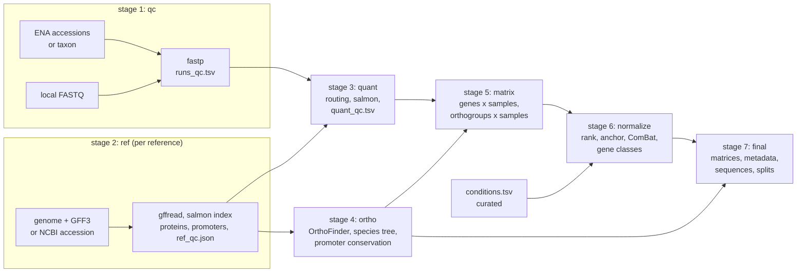

# igem-warsaw-rnaseq

Construction of unified gene expression datasets from public and local RNA-seq
data for one or more reference genomes, with orthology, normalisation and
promoter sequences for downstream modelling.

## Overview

igem-warsaw-rnaseq takes RNA-seq runs (ENA/SRA accessions, an NCBI taxon, or
local FASTQ files) and reference genomes (NCBI assembly accessions or local
FASTA + GFF3), and produces a dataset in which every sample is quantified against
the reference of its own taxon, genes are placed into orthogroups across
references, expression is normalised in several ways, and each gene is delivered
with its promoter, gene body and flanking sequences. The output is organised for
training sequence-to-expression models: splits never separate orthologues or
paralogs, and every table is validated against a schema.

The software was developed as an iGEM software project on the filamentous fungus
*Trichoderma atroviride*. Nothing in the method is specific to fungi; see
[Known limitations](#known-limitations) for the assumptions that hold.

## Contents

- [Motivation](#motivation)
- [Background](#background)
- [Workflow](#workflow)
- [Installation](#installation)
- [Usage](#usage)
- [Configuring a new dataset](#configuring-a-new-dataset)
- [Outputs](#outputs)
- [Interpretation](#interpretation)
- [Validation](#validation)
- [Known limitations](#known-limitations)
- [Repository layout](#repository-layout)
- [References](#references)
- [License](#license)

## Motivation

Public archives hold thousands of RNA-seq runs per organism, produced by
different laboratories with different protocols and quantified against
different annotations. Using them together requires requantifying every run
from raw reads against one reference per taxon, keeping track of which runs
belong to which study, and bringing genes of different genomes into a common
space. The pipeline performs these steps once, records every decision it makes
(dropped runs, chosen references, representative genes, fitted batches), and
exports the result in a form a model can consume directly.

## Background

**Quantification.** Reads are trimmed with fastp ([Chen et al. 2018](https://doi.org/10.1093/bioinformatics/bty560))
and quantified with salmon ([Patro et al. 2017](https://doi.org/10.1038/nmeth.4197))
against the full transcriptome of the reference, with the genome included as a
decoy so that reads from unannotated or non-transcribed regions are not forced
onto transcripts. Each run is routed to the reference whose NCBI taxon lies
deepest in the run's taxonomic lineage recorded by ENA.

**Orthology.** Proteomes (one protein per gene) are clustered into orthogroups
with OrthoFinder ([Emms and Kelly 2019](https://doi.org/10.1186/s13059-019-1832-y)).
A species tree is inferred from the concatenated single-copy orthologues with
MAFFT, trimAl and IQ-TREE. When a reference has several genes in an orthogroup,
the gene closest to the other references in OrthoFinder's gene tree represents
the orthogroup.

**Promoters.** The promoter of a gene is the sequence immediately upstream of
its start codon. The start codon is used as anchor because it is annotated for
every protein-coding gene in every annotation, whereas transcription start
sites are annotated only where transcript evidence exists and are frequently
inaccurate. Promoter conservation across references is compared with the
conservation of the encoded proteins and with the identity obtained on
nucleotide-shuffled promoters, which gives the baseline that alignment alone
produces.

**Normalisation.** Three per-sample views are produced. Ranks place each gene
by its position among all genes of the sample and are independent of scale.
Anchor normalisation subtracts the mean log-expression of reference genes
(supplied, or the most stable genes by geNorm, [Vandesompele et al. 2002](https://doi.org/10.1186/gb-2002-3-7-research0034)).
ComBat ([Johnson et al. 2007](https://doi.org/10.1093/biostatistics/kxj037))
removes the between-study component with study (BioProject) as batch. Genes are
classified from the distribution of their ranks across samples into
constitutive, silent, inducible and variable.

## Workflow



1. **Read QC** (`qc`). Run metadata is fetched from ENA (or read from a table of
   local files), reads are downloaded, verified against their MD5 checksums and
   trimmed with fastp. A run is dropped only for mechanical reasons: unknown
   accession, excluded sequencing platform, library that is not RNA-seq, failed
   download or checksum, fastp failure, or no reads after trimming.
2. **Reference preparation** (`ref`). For each reference the transcriptome, a
   transcript-to-gene map, one protein per gene, promoter sequences and a
   decoy-aware salmon index are built; `ref_qc.json` records gene and contig
   counts, annotation consistency and, optionally, BUSCO completeness.
3. **Quantification** (`quant`). Kept runs are routed to references and
   quantified with salmon including bootstrap replicates. Per run, gene-level
   counts, TPM and bootstrap variability are written; `quant_qc.tsv` reports
   mapping rate, decoy fraction, detected library type, detected genes and
   sample-to-sample similarity. Runs below the mapping-rate threshold are dropped.
4. **Orthology and phylogeny** (`ortho`). OrthoFinder, species tree, patristic
   distances and per-orthogroup protein and promoter conservation.
5. **Matrices** (`matrix`). Runs of one library are merged into samples;
   genes x samples matrices per reference and an orthogroups x samples matrix
   with one representative gene per orthogroup and reference.
6. **Normalisation** (`normalize`). Rank percentiles, anchor normalisation,
   ComBat and gene classes, in gene space and orthogroup space.
7. **Final dataset** (`final`). Wide matrices, sample and gene metadata,
   sequences, orthogroup-aware train/validation/test splits and a schema
   validation report.

Each per-run command is idempotent: runs already processed are skipped, and
`--task N` processes the N-th run for job arrays.

## Installation

The pipeline was developed and tested on Linux. It requires
[conda](https://docs.conda.io/) or [mamba](https://mamba.readthedocs.io/).

```bash
git clone https://github.com/StanGoleb/igem-warsaw-rnaseq.git
```

```bash
cd igem-warsaw-rnaseq
```

```bash
conda env create -f environment.yml
```

```bash
conda activate igem-warsaw-rnaseq
```

The environment provides Python 3.11 with pandas, numpy, pyarrow, matplotlib,
inmoose and pandera, and the tools fastp 1.4, salmon 1.12, gffread 0.12,
OrthoFinder 3, MAFFT 7.5, trimAl 1.5, IQ-TREE 3, BUSCO 6.1, SortMeRNA 4.3 and
MultiQC 1.35. Each command checks that the tools it needs are on `PATH` before
starting.

## Usage

A dataset is described by one YAML file (see
[Configuring a new dataset](#configuring-a-new-dataset)). The stages are run in
order:

```bash
igem-warsaw-rnaseq qc metadata      --config my.yaml
igem-warsaw-rnaseq qc run           --config my.yaml --all
igem-warsaw-rnaseq qc collect       --config my.yaml
igem-warsaw-rnaseq ref prepare      --config my.yaml --all
igem-warsaw-rnaseq ref promoters    --config my.yaml
igem-warsaw-rnaseq quant route      --config my.yaml
igem-warsaw-rnaseq quant run        --config my.yaml --all
igem-warsaw-rnaseq quant collect    --config my.yaml
igem-warsaw-rnaseq ortho run        --config my.yaml
igem-warsaw-rnaseq ortho tree       --config my.yaml
igem-warsaw-rnaseq ortho conservation --config my.yaml
igem-warsaw-rnaseq matrix build     --config my.yaml
igem-warsaw-rnaseq normalize run    --config my.yaml
igem-warsaw-rnaseq final build      --config my.yaml
```

`qc run` and `quant run` accept `--run ACCESSION`, `--task N` (the N-th
eligible run, 1-based), `--all` or `--list`; `--force` reprocesses. Stages that
write a single product (`ortho`, `ref prepare`) skip when the product exists and
rebuild with `--force`, removing products that depend on it.

The complete example on two *Saccharomyces* genomes and eleven public runs
(about 0.7 GB downloaded, 15 minutes on 8 cores) is run with:

```bash
bash examples/yeast/run.sh
```

Conditions (treatment categories per sample) are curated outside the pipeline;
[docs/conditions_prompt.md](docs/conditions_prompt.md) describes the procedure
and provides a prompt for a language model.

## Configuring a new dataset

`config/default.yaml` lists every option with its default. A minimal file:

```yaml
qc:
  runs:
    accessions_file: runs.txt        # one ENA/SRA run accession per line
    # taxon_id: 5543                 # or: every TRANSCRIPTOMIC run under a taxon
    # local_file: runs_local.tsv     # and/or: local FASTQ files (see below)

references:
  species_a:
    ncbi_accession: GCF_000000000.1  # downloaded from NCBI Datasets
    tax_id: 12345                    # runs under this taxon are quantified here
  species_b:
    genome: refs/b/genome.fna.gz     # or local FASTA + GFF3
    annotation: refs/b/annotation.gff3.gz
    tax_id: 67890
    anchor_genes: []                 # optional reference genes for anchoring
```

Paths are relative to the configuration file. Local reads are described by a
tab-separated table:

| column | required | content |
|---|---|---|
| `run_id` | yes | unique run identifier |
| `fastq_1` | yes | FASTQ path, gzipped or plain, relative to the table |
| `fastq_2` | no | second mate for paired-end reads |
| `reference` | yes | name from `references` |
| `batch` | yes | batch label, used like a BioProject |
| `sample` | no | sample identifier; runs sharing it are merged |

Local and public runs may be combined in one analysis. Local runs skip download
and checksum verification; everything else is identical.

Settings worth knowing: `ref.promoter_bp` (promoter length, default 800),
`quant.gates.min_pct_mapped` (default 5), `normalize.combat.min_batch_size`
(default 2), `ref.busco.lineage` (required when BUSCO is enabled),
`qc.rrna.enabled` (rRNA screening with SortMeRNA, off by default because of its
cost).

## Outputs

Every stage writes into its own directory (`qc.output_dir`, `ref.output_dir`,
and so on). The files consumed by later stages and the delivered dataset are:

| file | content |
|---|---|
| `qc/runs_qc.tsv` | one row per run: ENA metadata, MD5 status, read counts before and after trimming, mean read length, Q30 and adapter percentages, rRNA percentage, decision and reason |
| `qc/fastq_trimmed/` | trimmed reads |
| `ref/<reference>/` | `transcripts.fa`, `proteins.fa` (one per gene, named by gene), `t2g.tsv`, `promoters_<bp>bp.fa`, `salmon_index/`, `ref_qc.json` |
| `quant/quant_qc.tsv` | one row per run: reference, mapping rate, decoy fraction, library type, detected genes, PCA coordinates, median Spearman correlation to other runs, decision |
| `quant/quant_gene/<run>.tsv` | per gene: counts, TPM, bootstrap CV |
| `ortho/orthofinder/` | OrthoFinder tables, gene trees (`gene_trees.tsv`) |
| `ortho/species_tree.nwk`, `ortho/patristic_distances.tsv` | species tree and leaf-to-leaf distances |
| `ortho/promoter_conservation.tsv` | per single-copy orthogroup: protein identity, promoter identity, shuffled-promoter identity |
| `matrix/` | parquet matrices per reference and in orthogroup space, `samples.tsv`, `orthogroup_representative.tsv` |
| `normalized/` | long tables of all normalised layers, `gene_summary.parquet`, `anchors.tsv`, `combat_log.json` |
| `final/` | the delivered dataset, below |

The final dataset:

```
all_genes_scope/{rank,anchor,combat}.tsv.gz   genes x samples (ID, reference, gene_id, orthogroup)
og_scope/{rank,anchor,combat}.tsv.gz          orthogroups x samples
samples_metadata.tsv                          sample, reference, BioProject, runs, QC, condition
genes_metadata.tsv                            gene index, orthogroup, class, conservation, split
orthology/gene_index.tsv                      dataset-wide gene key <reference>_G<n>
orthology/orthogroup_representative.tsv       which gene represents each (orthogroup, reference)
sequences/sequences.tsv.gz                    SPECIES, SEQUENCE, GROUP, ID, OG_ID, GENE_ID
sequences/promoters.fasta, promoters.bed      promoter windows for motif scans
split_assignment.tsv                          orthogroup to train/val/test, with the seed
schema_validation.json                        pandera report
```

`sequences.tsv.gz` holds four rows per gene: `FlankLeft` (1000 bp upstream of
the promoter), `Promotor` (`ref.promoter_bp` upstream of the start codon),
`Gene` (start to stop codon, genomic) and `FlankRight` (1000 bp downstream),
each 5' to 3' in the gene's orientation and clipped at contig ends.

Normalised layers:

- `rank`: within-sample rank divided by the number of genes ranked, 0 for the
  strongest gene; zero-expression and absent genes are 1.
- `anchor`: log2(TPM + 1) minus the per-sample mean log2(TPM + 1) of the anchor
  genes; the genes used and their source (`config` or `genorm`) are in
  `anchors.tsv`.
- `combat`: ComBat on log2(TPM + 1) with BioProject as batch, fitted per
  reference and in orthogroup space; samples from BioProjects smaller than
  `min_batch_size` are left empty, which `samples_metadata.tsv` records in
  `batch_corrected`.

Gene classes in `genes_metadata.tsv`: `constitutive` (rank stays within a
window of width 0.10 in at least 95% of samples and the gene is expressed),
`silent` (stable but unexpressed), `inducible` (reaches the top decile with a
swing of at least 0.30 from its median rank), `variable` (the rest);
`is_strong` marks constitutive genes in the top decile.

## Interpretation

- **Decisions are mechanical, biology is reported.** Runs are dropped for
  failed downloads, wrong library types or a mapping rate below the threshold,
  never for Q30, adapter content or rRNA fraction, which are reported so that a
  user can set gates (`qc.gates`) with knowledge of the data.
- **Mapping rate separates mislabelled runs.** A run that maps far below the
  others of its reference is usually from a different organism or a different
  library type; `pct_decoy` distinguishes genomic DNA or unspliced RNA (high
  decoy fraction) from foreign material (low mapping and low decoy).
- **Promoter identity needs its baseline.** `prom_mean_pid` alone overstates
  conservation because alignment of any two sequences yields some identity;
  `prom_background_pid` is that baseline for the same sequences shuffled, and
  `prom_above_background` is false where the promoters are not more similar
  than chance.
- **Representatives are traceable.** `orthogroup_representative.tsv` states
  for each (orthogroup, reference) which gene stands for the orthogroup and by
  which rule (`single_copy`, `gene_tree`, `max_mean_tpm`, `longest_protein`),
  so a value in `og_scope` can always be traced to one gene.
- **Splits respect orthology.** Train, validation and test are assigned per
  orthogroup; genes without an orthogroup are their own groups.

## Validation

Results obtained with the current code on `examples/yeast` (*S. cerevisiae*
S288C GCF_000146045.2, *S. paradoxus* CBS 432 GCF_002079055.1, eleven ENA runs
from four BioProjects):

- Reference preparation: 6477 and 5840 genes; BUSCO (saccharomycetes_odb12)
  completeness 99.9% and 99.8%.
- Quantification: 8 of 11 runs kept with mapping rates of 33 to 85%; the three
  runs of one BioProject labelled *S. paradoxus* mapped 0% and were dropped.
- Orthology: 5410 orthogroups, 5262 single-copy; promoter identity 85.2%
  (median) against a shuffled baseline of 43.6%, protein identity 93.4%; 5252 of
  5262 orthogroups above baseline.
- Normalisation: ComBat fitted for *S. cerevisiae* (2 BioProjects, 6 samples)
  and in orthogroup space (3 BioProjects, 8 samples), skipped for *S. paradoxus*
  (one BioProject) with the reason recorded.
- Final dataset: 12317 genes, 46260 sequence rows, 0 orthogroups spanning more
  than one split, schema validation passed.

A run on four *Trichoderma* references and four runs of *T. atroviride*
produced the same structure (12810 orthogroups, 7068 single-copy; promoter
identity 51 to 55% against a 38 to 40% baseline).

The unit tests (94) cover the pure computations: rank percentiles and gene
classes, geNorm, lane merging, bootstrap CV, Newick parsing and patristic
distances, gap-excluded identity, promoter and flank windows on both strands,
representative selection, split assignment and the schema checks.

## Known limitations

- **Promoters are anchored on the start codon.** For fungi and plants the
  annotated transcription start lies within 800 bp of the start codon for
  about 96% of genes (measured on RefSeq annotations of *T. atroviride*,
  *S. cerevisiae*, *A. thaliana*); for vertebrates the fraction is about 70%
  because 5' UTRs frequently contain long introns. Experimentally determined
  transcription start sites are not used.
- **One transcriptional unit per gene is assumed.** Genomes with polycistronic
  transcription (bacteria, kinetoplastids) yield promoters only for the first
  gene of each unit.
- **Proteins are translated with the standard genetic code.** Mitochondrial,
  plastid and alternative nuclear codes are not applied; affected proteins may
  carry wrong residues or be truncated.
- **Resources scale with genome size.** The genome is loaded into memory and
  indexed as a decoy; a 3 Gb genome needs tens of gigabytes of memory. The
  species tree uses all single-copy orthologues.
- **ENA is the only public source.** Runs absent from ENA (for example some
  dbGaP-controlled data) are not reachable.

## Repository layout

```
environment.yml          conda environment
pyproject.toml           package metadata; installs the igem-warsaw-rnaseq command
config/default.yaml      every option with its default
src/igem_warsaw_rnaseq/  one subpackage per stage: qc, ref, quant, ortho, matrix, normalize, final
tests/                   unit tests (pytest)
examples/yeast/          configuration, run list and run script of the example
docs/conditions_prompt.md  procedure and prompt for condition curation
```

## References

Tools used by the pipeline:

- Chen S, Zhou Y, Chen Y, Gu J (2018). fastp: an ultra-fast all-in-one FASTQ
  preprocessor. *Bioinformatics* 34:i884-i890.
  [doi:10.1093/bioinformatics/bty560](https://doi.org/10.1093/bioinformatics/bty560)
- Patro R, Duggal G, Love MI, Irizarry RA, Kingsford C (2017). Salmon provides
  fast and bias-aware quantification of transcript expression. *Nature Methods*
  14:417-419. [doi:10.1038/nmeth.4197](https://doi.org/10.1038/nmeth.4197)
- Pertea G, Pertea M (2020). GFF Utilities: GffRead and GffCompare.
  *F1000Research* 9:304.
  [doi:10.12688/f1000research.23297.2](https://doi.org/10.12688/f1000research.23297.2)
- Emms DM, Kelly S (2019). OrthoFinder: phylogenetic orthology inference for
  comparative genomics. *Genome Biology* 20:238.
  [doi:10.1186/s13059-019-1832-y](https://doi.org/10.1186/s13059-019-1832-y)
- Katoh K, Standley DM (2013). MAFFT multiple sequence alignment software
  version 7. *Molecular Biology and Evolution* 30:772-780.
  [doi:10.1093/molbev/mst010](https://doi.org/10.1093/molbev/mst010)
- Capella-Gutierrez S, Silla-Martinez JM, Gabaldon T (2009). trimAl: a tool for
  automated alignment trimming. *Bioinformatics* 25:1972-1973.
  [doi:10.1093/bioinformatics/btp348](https://doi.org/10.1093/bioinformatics/btp348)
- Minh BQ, Schmidt HA, Chernomor O, et al. (2020). IQ-TREE 2: new models and
  efficient methods for phylogenetic inference in the genomic era. *Molecular
  Biology and Evolution* 37:1530-1534.
  [doi:10.1093/molbev/msaa015](https://doi.org/10.1093/molbev/msaa015)
- Manni M, Berkeley MR, Seppey M, Simao FA, Zdobnov EM (2021). BUSCO update.
  *Molecular Biology and Evolution* 38:4647-4654.
  [doi:10.1093/molbev/msab199](https://doi.org/10.1093/molbev/msab199)
- Kopylova E, Noe L, Touzet H (2012). SortMeRNA: fast and accurate filtering of
  ribosomal RNAs in metatranscriptomic data. *Bioinformatics* 28:3211-3217.
  [doi:10.1093/bioinformatics/bts611](https://doi.org/10.1093/bioinformatics/bts611)
- Ewels P, Magnusson M, Lundin S, Kaller M (2016). MultiQC: summarize analysis
  results for multiple tools and samples in a single report. *Bioinformatics*
  32:3047-3048.
  [doi:10.1093/bioinformatics/btw354](https://doi.org/10.1093/bioinformatics/btw354)

Methods:

- Vandesompele J, De Preter K, Pattyn F, et al. (2002). Accurate normalization
  of real-time quantitative RT-PCR data by geometric averaging of multiple
  internal control genes. *Genome Biology* 3:research0034.
  [doi:10.1186/gb-2002-3-7-research0034](https://doi.org/10.1186/gb-2002-3-7-research0034)
- Johnson WE, Li C, Rabinovic A (2007). Adjusting batch effects in microarray
  expression data using empirical Bayes methods. *Biostatistics* 8:118-127.
  [doi:10.1093/biostatistics/kxj037](https://doi.org/10.1093/biostatistics/kxj037)

Thresholds adopted from other software: the mapping-rate gate of 5% is the
default of nf-core/rnaseq; the suggested optional gates of 80% Q30 and 10%
adapter content are the Illumina run specification and the FastQC failure
threshold.

## License

This software is released under the GNU General Public License v3.0 (see
[LICENSE](LICENSE)). Sequence data and genome annotations are downloaded from
ENA and NCBI at run time and are not redistributed in this repository.
